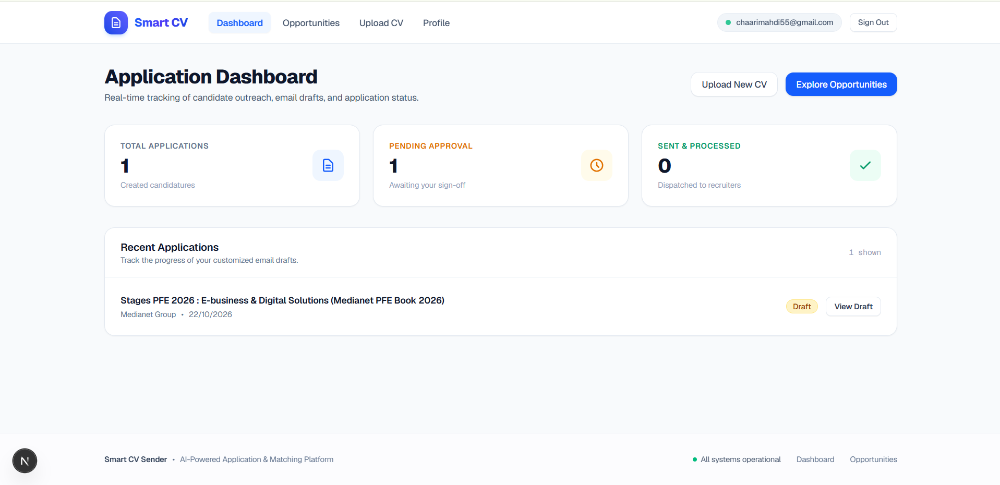
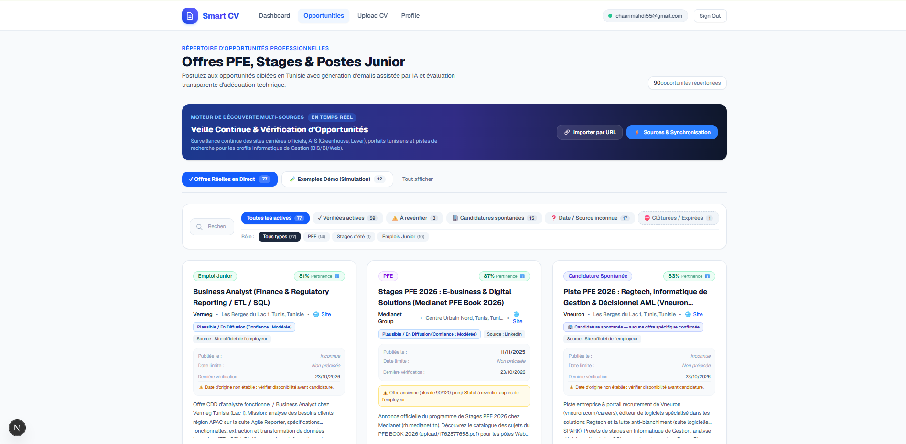
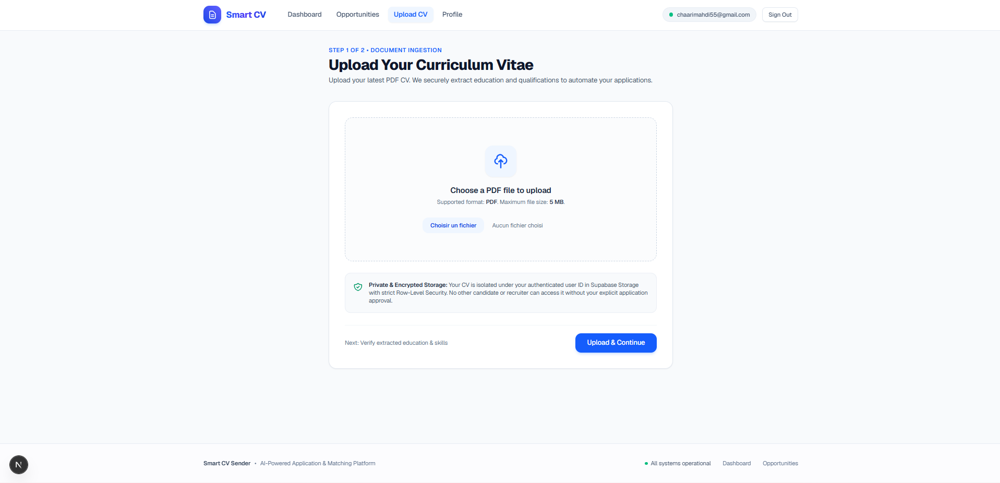
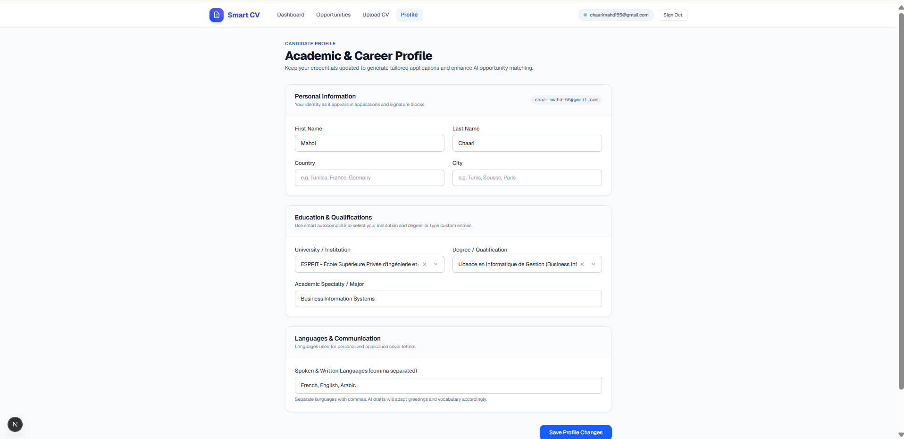

# Smart CV Sender

[](https://smart-cv-sender-freelance-35e641c4.vercel.app)
[-black?style=for-the-badge&logo=next.js)](https://nextjs.org/)
[](https://react.dev/)
[](https://www.typescriptlang.org/)
[](https://supabase.com/)
[-brightgreen?style=for-the-badge&logo=node.js)](https://nodejs.org/)

**Smart CV Sender** is an intelligent, privacy-first career platform designed for students, engineering interns (PFE), and junior professionals in Tunisia and the EMEA region. It bridges the gap between candidates and genuine opportunities through transparent relevance scoring, multi-source opportunity discovery, and fact-grounded cover email generation protected by cryptographic integrity and distributed database leases.

---

## 🌐 Live Website & Production Access

- **Public Production URL**: [https://smart-cv-sender-freelance-35e641c4.vercel.app](https://smart-cv-sender-freelance-35e641c4.vercel.app)
- **Deployment Platform**: Vercel Serverless & Edge Network (Region `fra1` Frankfurt)
- **Database Backend**: Supabase Managed PostgreSQL 15 (Frankfurt, SSL Enforced, Row-Level Security Enabled)
- **Email Dispatch Mode**: **Simulated Mock Dispatch** (`AI_PROVIDER_TYPE=mock`). In accordance with strict ethical and anti-spam standards, real outbound emails are simulated and safely logged into an immutable append-only audit trail without sending unsolicited external messages.

---

## 📸 Application Showcase

### 1. Curated Opportunities & Multi-Factor Relevance Scoring
Transparent discovery of verified Tunisian PFE programs, Tech internships, and junior vacancies with deterministic candidate fit breakdown (Skills, Projects, Education, Seniority).



### 2. Cryptographic Draft Editor & Tamper-Proof Approvals
Fact-grounded email generation with strict SHA-256 snapshot hashing across candidate CV facts, body content, recipient address, and attached resume.



### 3. Calendar Availability Intelligence & Conflict Resolution
Automatic detection of graduation session vs. internship start conflicts with candidate decision branching (compatibility confirmation, spontaneous application conversion, or postponement).



### 4. Candidate Dashboard & Real-Time Tracking
Unified lifecycle tracking for applications across all states (`draft`, `approved`, `sending`, `sent`, `failed`, `postponed`) with tamper protection.



---

## 🛡️ Enterprise Security & Architecture Highlights

### 1. Distributed Fencing Tokens & Monotonic Lease Locking
To eliminate race conditions and split-brain execution across serverless workers (Vercel cold restarts, network retries), email dispatches are governed by an atomic lease acquisition protocol:
- **Monotonic Fencing Tokens**: Stored in `dispatch_leases`, every lease acquisition increments a 64-bit integer token.
- **Worker Ownership Verification**: Prevents stale, zombie, or timed-out workers from committing results after a lease has expired or been re-acquired by a newer worker.
- **Unconditional Token Enforcement**: Database transitions to `sent` or `failed` strictly reject missing or out-of-order tokens.

```
Candidate Send Click
        │
        ▼
acquire_mock_dispatch_lease(app_id, worker_id, tracking_key)
        │
  [Acquired? (fencing_token = N)]
        │
        ├── No ──► Reject / Return Retry-After Seconds
        │
        └── Yes ─► Run Mock Send Simulation
                      │
                      ▼
        transition_application_status_atomic(
          p_application_id, 'sent', p_fencing_token = N
        )
                      │
        [Token Validated & Lease Finalized]
                      │
                      ▼
        Application Marked 'sent' + Immutable Audit Event Appended
```

### 2. Finite State Machine with Terminal Immutability
All status transitions are enforced by the `transition_application_status_atomic` PostgreSQL procedure and backed by TypeScript domain types:
- **Terminal State**: Applications in `sent` status are permanently immutable. They cannot be reopened, transitioned to draft, or modified.
- **Forbidden Transitions**: Strict guardrails forbid illegal hops (e.g., `sending -> postponed`, `sent -> draft`, `postponed -> approved`).
- **Deletion Protection**: A native database trigger (`trg_prevent_sent_application_deletion`) blocks `DELETE` operations on any application in `sending` or `sent` status.

### 3. PostgREST Privilege Hardening & RPC Exclusivity
- **Revoked Mutations**: Direct `UPDATE` operations on `applications` and `email_drafts` are completely revoked for `authenticated` and `anon` roles via PostgREST.
- **SECURITY DEFINER RPCs**: All mutations must proceed through audited atomic stored procedures (`save_email_draft_atomic`, `approve_email_draft_atomic`, `transition_application_status_atomic`, `delete_application_atomic`).
- **Row-Level Security (RLS)**: Enforced across all tables (`applications`, `email_drafts`, `email_events`, `dispatch_leases`, `rate_limits`). Candidates can only read and mutate their own records.

### 4. Immutable Append-Only Audit Trail
- The `email_events` table logs all lifecycle milestones (`approved`, `sent`, `failed`).
- A PostgreSQL trigger (`trg_email_events_immutable`) intercepts and raises exceptions on any `UPDATE` or `DELETE` statement, even when attempted by administrative service roles.
- Referential integrity uses `ON DELETE RESTRICT` on `email_events.application_id` to guarantee permanent legal and compliance records.

### 5. Multi-Layer SSRF & Prompt Injection Defense
- **SSRF Guard**: Custom streaming fetch engine that validates all target URLs and resolved IP addresses against IPv4/IPv6 private ranges, loopback addresses (`127.0.0.1`, `::1`), link-local prefixes, and cloud metadata endpoints (`169.254.169.254`).
- **Prompt Isolation**: Sanitizes LLM inputs, strips ChatML/delimiter tags, and isolates candidate facts inside untrusted content envelopes to prevent prompt injection.

---

## 📊 Quality Gates & Test Suite

The project enforces automated test coverage across unit, integration, and security layers:

| Test Domain | Coverage Scope | Status |
|:---|:---|:---:|
| **Application State Machine** | Valid transitions, terminal immutability, forbidden states | ✅ 7 / 7 Passed |
| **Idempotency & Fencing** | Tracking key stability, fencing validation, duplicate suppression | ✅ 6 / 6 Passed |
| **RPC Client & Error Handling** | Bounded jittered retries, deadlock recovery, side-effect isolation | ✅ 9 / 9 Passed |
| **Upload & CV Parsing** | File magic numbers, size bounds, safe PDF text extraction | ✅ 6 / 6 Passed |
| **Draft Integrity & Hashing** | SHA-256 draft snapshots, attachment verification, tamper invalidation | ✅ 10 / 10 Passed |
| **SSRF Defense & IP Enforcer** | Loopback, IPv6/NAT64, Cloud Metadata, Max redirects | ✅ 17 / 17 Passed |
| **Relevance & Scoring Engine** | 4-Pillar calculation, seniority caps, calendar availability | ✅ 25 / 25 Passed |
| **Tunisian Opportunities & PFE** | Live vacancy scrapers, ATS feeds, deduplication, demo isolation | ✅ 48 / 48 Passed |
| **Security Audit & Schema** | Non-destructive migrations, privilege revokes, trigger integrity | ✅ 150+ Passed |
| **Total Automated Tests** | **Full Suite (`node:test`)** | **✅ 288 / 288 Passed** |

```bash
# Execute full automated test suite
npm test

# Run TypeScript strict type verification
npm run typecheck

# Run ESLint validation
npm run lint

# Compile Next.js Turbopack production build (15/15 routes)
npm run build
```

---

## 🚀 Local Development Setup

### 1. Prerequisites
- **Node.js**: v20.x or v24.x LTS
- **npm**: v10+
- **Git**

### 2. Clone and Install
```bash
git clone https://github.com/chaarimahdi100-coder/smart-cv-sender.git
cd smart-cv-sender
npm install
```

### 3. Environment Configuration
Create a `.env.local` file modeled on `.env.example`:
```env
NEXT_PUBLIC_SUPABASE_URL="https://your-project.supabase.co"
NEXT_PUBLIC_SUPABASE_ANON_KEY="your-anon-key"
SUPABASE_SERVICE_ROLE_KEY="your-service-role-key"

# AI Provider ("gemini" or "mock")
AI_PROVIDER_TYPE="mock"
GEMINI_API_KEY=""

NEXT_PUBLIC_APP_URL="http://localhost:3000"
```

### 4. Database Migrations
Migrations are managed in `supabase/migrations/`:
```bash
# Apply migrations sequentially
# Migration 013 (20240113000000_fencing_and_atomic_lifecycle.sql) establishes the complete atomic lifecycle
```

### 5. Launch Local Development Server
```bash
npm run dev
# Open http://localhost:3000 in your browser
```

---

## 📄 License & Attribution

This project is open-source under the [MIT License](LICENSE).  
Built with pride for Tunisian engineering students and junior tech talent.
